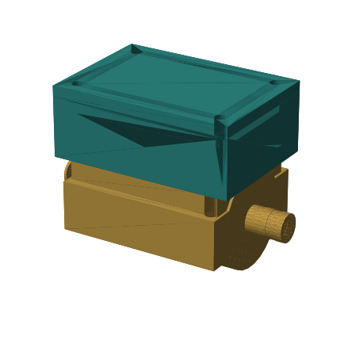
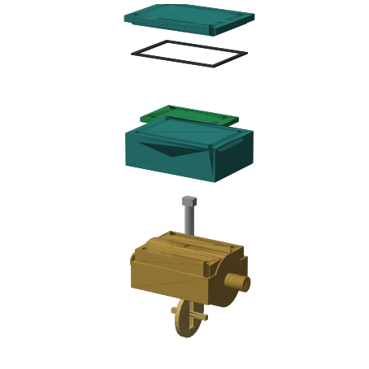
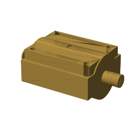
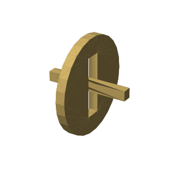
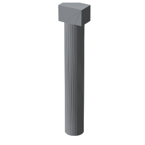
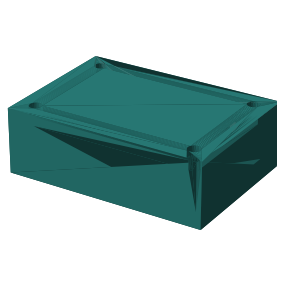
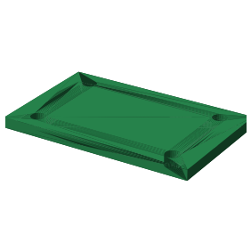
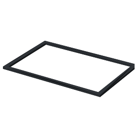
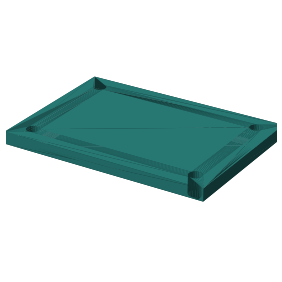
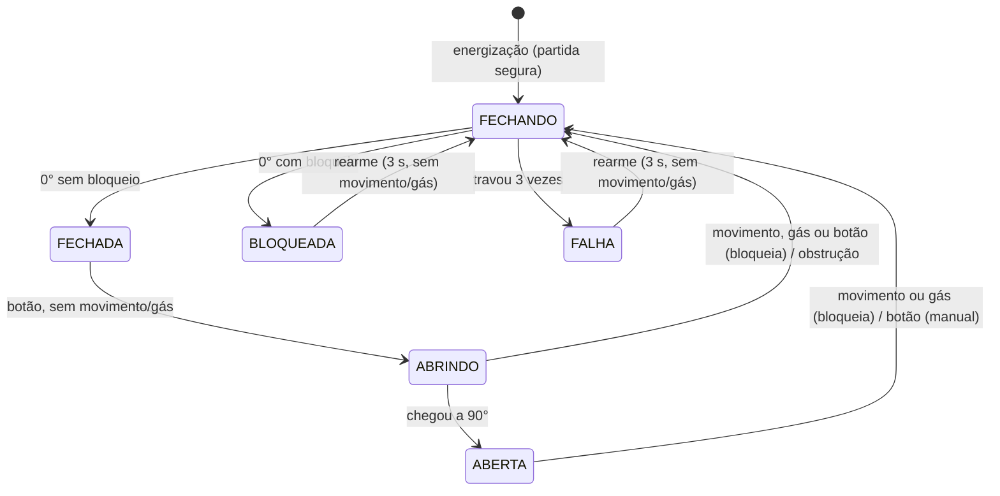

<h1 align="center">Corte Gás 10 mm</h1>

<p align="center">
  
</p>

<p align="center">
  Válvula borboleta de 90° para tubo de Ø10 mm com <b>corte imediato de gás</b><br>
  acionado por sensor de movimento (PIR), detector de gás e botão.
</p>

<p align="center">
  
</p>
<p align="center"><sub>Vista explodida, de baixo para cima: obturador, corpo, eixo, caixa eletrônica, placa de sensores, junta e tampa.</sub></p>

> **Protótipo educacional.** Não instale em linha de gás real sem projeto, componentes certificados e
> responsável técnico habilitado. Veja [Avisos de segurança](#avisos-de-segurança).

**88 × 50 × 62 mm** · passagem Ø10 mm · curso de 90° · 12 V · Arduino / ESP32

## As peças

<table>
  <tr>
    <td align="center"><br><b>Corpo</b><br>88 × 50 × 36 mm<br><sub>Canal Ø10, câmara Ø32, 4× M4</sub></td>
    <td align="center"><br><b>Obturador</b><br>Ø32 × 3 mm<br><sub>Gira 90° para abrir/fechar</sub></td>
    <td align="center"><br><b>Eixo</b><br>Ø6 × 43 mm<br><sub>Ponta superior leva o ímã</sub></td>
  </tr>
  <tr>
    <td align="center"><br><b>Caixa eletrônica</b><br>68 × 48 × 22 mm<br><sub>3 passagens Ø7 mm</sub></td>
    <td align="center"><br><b>Placa de sensores</b><br>54 × 34 × 3 mm<br><sub>AS5600 sobre o eixo</sub></td>
    <td align="center"><br><b>Junta</b><br>62 × 42 × 1 mm<br><sub>Veda a caixa</sub></td>
  </tr>
  <tr>
    <td align="center"><br><b>Tampa</b><br>68 × 48 × 6 mm<br><sub>4 furos de fixação</sub></td>
    <td colspan="2" align="center"><sub>Malhas STL em <a href="cad/stl">cad/stl</a>. No projeto final, corpo, obturador e eixo são usinados em <b>latão</b>.</sub></td>
  </tr>
</table>

## Sumário
- [Estrutura do repositório](#estrutura-do-repositório)
- [Como funciona](#como-funciona)
- [Hardware](#hardware)
- [Sensores recomendados](#sensores-recomendados)
- [Firmware](#firmware)
- [Publicar no GitHub](#publicar-no-github)
- [Avisos de segurança](#avisos-de-segurança)
- [Referências](#referências)
- [Licença](#licença)

## Estrutura do repositório

```
.
├── img/                        renderizações 3D das peças
├── firmware/
│   └── firmware_corte_gas_10mm/
│       └── firmware_corte_gas_10mm.ino
├── cad/stl/                    malhas STL das 7 peças
├── publicar_github.sh          cria o repositório e envia tudo
├── LICENSE
└── README.md
```

## Como funciona

| Ângulo | Disco | Válvula |
|---|---|---|
| 0° | perpendicular ao fluxo | fechada |
| 90° | alinhado ao fluxo | aberta |

Sem fins de curso: um ímã diametral na ponta do eixo fica sob o encoder **AS5600** (I²C), que informa o
ângulo. Motor acionado com ângulo parado significa travamento (*stall*).

### Lógica de segurança
- **Partida segura:** ao energizar, a válvula sempre fecha primeiro, referenciando o zero do AS5600.
- **Corte imediato (0 s):** movimento ou gás com a válvula ABRINDO/ABERTA fecha na mesma iteração do `loop()`
  (`T_CORTE_VAZAMENTO = 0`). Não há pré-alarme.
- **Alarme:** buzzer contínuo e LED vermelho durante e após o corte.
- **Bloqueio persistente:** o estado BLOQUEADA é gravado na EEPROM e sobrevive a queda de energia.
- **Abertura negada** com movimento, gás ou sensores ainda aquecendo (30 s).
- **Rearme:** segurar o botão por 3 s seguidos, e só vale sem movimento e sem gás.
- **Fechar é crítico:** se travar, tenta desencravar 2 vezes e depois entra em `FALHA` com alarme.

### Botão único
| Gesto | Estado | Resultado |
|---|---|---|
| Toque curto | Fechada | Abre (se permitido) |
| Toque curto | Aberta | Fecha (manual, sem bloqueio) |
| Toque durante a abertura | Abrindo | Emergência do botão: fecha e bloqueia |
| Segurar 3 s | Bloqueada / Falha | Rearme |

### Máquina de estados


## Hardware

- Corpo de latão 88 × 50 × 62 mm, passagem Ø10, obturador Ø32 × 3 mm, eixo Ø6.
- Encoder AS5600 (I²C) + ímã diametral.
- Motor DC com redutor + ponte H (L9110 ou DRV8833).
- Arduino Nano / Pro Mini ou ESP32 / ESP32-C3.
- Opcional: eletroválvula **normalmente fechada** em série (saída `PIN_SOL_GAS`), para corte direto na linha e
  corte sem energia.

### Passagens de cabo (3 × Ø7 mm)
| Posição | Função |
|---|---|
| x = −20 | Alimentação 12 V |
| x = 0 | Sensor de movimento (PIR), HIGH = presença |
| x = +20 | Detector de gás (saída digital) e, opcionalmente, botão remoto (cabo multivias ≤ ≈ 6,5 mm) |

### Pinagem
| Função | Arduino Nano / Pro Mini | ESP32 / ESP32-C3 |
|---|---|---|
| SDA / SCL (AS5600) | A4 / A5 | 8 / 9 |
| Ponte H IN1 / IN2 (PWM) | 5 / 6 | 3 / 4 |
| Sensor de movimento (PIR) | 2 | 5 |
| Detector de gás (digital) | 3 | 6 |
| Eletroválvula NF (opcional) | 7 | 1 |
| Botão (comando e rearme) | 4 | 7 |
| Buzzer | 9 | 2 |
| LED verde / vermelho | 10 / 11 | 20 / 21 |

No ESP32-C3, os GPIO 20/21 coincidem com a UART0; mude-os se usar `Serial` por ela.
No AVR, ligue 10 kΩ para GND na saída do PIR.

## Sensores recomendados

**Movimento ou presença**

| Sensor | Quando usar | Observação |
|---|---|---|
| HC-SR501 (PIR) | O mais barato e fácil de achar | Aquece ≈ 1 min; falsos disparos com variação de temperatura |
| AM312 (mini PIR) | Compacto, 3,3 V | Menos falso disparo; alcance curto (≈ 3 a 5 m) |
| Panasonic EKMB / EKMC | Instalação mais séria | Saída digital limpa, baixo consumo; mais caro |
| HLK-LD2410C (mmWave 24 GHz) | Detectar pessoa parada | Saída OUT digital em 3,3 V; ajustar alcance e sensibilidade |
| RCWL-0516 (micro-ondas) | Só como reforço | Atravessa paredes; interferência |

**Gás:** MQ-6 ou MQ-5 para botijão (GLP); MQ-4 para gás encanado (metano). O elemento do MQ é aquecido e precisa
de aquecimento prévio (`T_AQUECIMENTO`). O movimento é lido **sem filtro**: um PIR com falsos disparos fecha e bloqueia a válvula.

## Firmware

Arquivo: [`firmware/firmware_corte_gas_10mm/firmware_corte_gas_10mm.ino`](firmware/firmware_corte_gas_10mm/firmware_corte_gas_10mm.ino)

1. Abra o `.ino` na Arduino IDE (a pasta tem o mesmo nome do sketch).
2. Escolha a placa e a porta. `Wire` e `EEPROM` já vêm com o núcleo. No ESP32 use o core Arduino-ESP32 **≥ 3.0**
   (`analogWrite` e `tone`).
3. Ajuste no topo: `USAR_SENSOR_GAS`, `USAR_SOLENOIDE_AUX`, `GAS_NIVEL_ATIVO`, `T_AQUECIMENTO`.
4. Compile e grave.

### Console serial (115200 baud)
| Comando | Ação |
|---|---|
| `Z` | Grava a posição atual como FECHADO (0°). Recusado com a válvula em movimento |
| `I` | Inverte o sentido de leitura do encoder |
| `A` / `F` | Abre / fecha (`A` segue as mesmas negações de segurança) |
| `?` | Estado, ângulo, movimento, gás, bloqueio, sentido e ímã |

Calibração: com o disco fechado, envie `Z`. Se o ângulo cresce ao fechar, envie `I`.

### Parâmetros principais
| Constante | Valor | Descrição |
|---|---|---|
| `T_CORTE_VAZAMENTO` | 0 s | Atraso do corte (sem pré-alarme) |
| `T_SEGURAR_REARME` | 3 s | Botão pressionado para rearmar |
| `T_AQUECIMENTO` | 30 s | Abertura negada enquanto PIR/MQ estabilizam |
| `T_FILTRO_GAS` | 300 ms | Anti-ruído do comparador do módulo de gás |
| `T_MANOBRA_MAX` | 8 s | Tempo máximo de uma manobra de 90° |
| `T_STALL` | 1,2 s | Sem mover = travado |
| `TOLERANCIA` | 2,5° | Janela de "chegou" |

## Publicar no GitHub

```bash
chmod +x publicar_github.sh
./publicar_github.sh SEU-USUARIO NOME-DO-REPO
```

O script usa a [GitHub CLI](https://cli.github.com/) (`gh`) se estiver instalada e autenticada; caso contrário,
configura o `origin` HTTPS e envia com `git push` (crie antes o repositório vazio em github.com/new).

Manualmente:

```bash
git init -b main
git add .
git commit -m "Corte Gás 10 mm: firmware e CAD"
git remote add origin https://github.com/SEU-USUARIO/NOME-DO-REPO.git
git push -u origin main
```

## Avisos de segurança

- **Estanqueidade:** disco rígido de 3 mm em câmara Ø32 não veda gás. Use sede elastomérica (NBR/Viton) e teste;
  para corte direto, eletroválvula NF certificada em série.
- **Faíscas:** motor DC com escovas é fonte de ignição. Caixa selada e fora de área com gás acumulado, ou motor sem escovas.
- **Sem energia:** a válvula motorizada fica onde estava. Só eletroválvula NF fecha sem energia.
- **Sensores MQ não são certificados:** servem para prototipar; use também detector comercial certificado (INMETRO).
- **Fio rompido** lê "sem movimento / sem gás": considere supervisão de linha e watchdog.
- O GLP é mais pesado que o ar e se acumula junto ao piso.

## Referências

1. ILHAMDI, L.; FIKRY, M.; AIDILOF, H. A. K. Smart Fire Prevention: An IoT Approach to Detecting LPG Leaks and Fire Hazards. *ICOMDEN*, v. 2, 2024.
2. VIGNESH, S.; PRIYADHARSHINI, K. Smart Gas Leak Detection and Automated Shutoff System Using ESP32. *IJEDR*, v. 14, n. 1, 2026.
3. FAYE, P. et al. Smart IoT Based Gas Leakage Detection and Auto Shut-Off System. *IJACECT*, v. 14, n. 1, 2025.
4. JFGONJR. [Controlador de Fluido 10mm](https://github.com/jfgonjr/controlador-de-fluido-10mm).

## Licença

Firmware sob [MIT](LICENSE). Os STL em `cad/` derivam do repositório original; confira a licença do autor.
